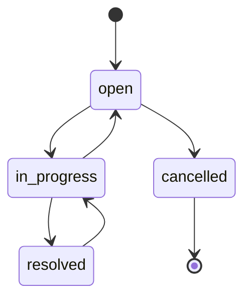

# SupportDesk API

A focused **Python + FastAPI + SQLite** portfolio project: a support-ticket workflow with input validation, an event history, and protection against concurrent updates overwriting each other.

The interesting part is the behavior under failure: an invalid transition changes nothing, a stale edit returns `409`, and each accepted state change commits together with its audit event.

## Quick start

Requires **Python 3.12+**. Run from the repository root.

```bash
python -m venv .venv
source .venv/bin/activate
python -m pip install -r requirements-dev.txt
export SUPPORTDESK_API_KEY="$(python -c 'import secrets; print(secrets.token_urlsafe(32))')"
uvicorn api:create_app --factory --host 127.0.0.1 --port 8000
```

On Windows PowerShell, use `.venv\Scripts\Activate.ps1` and set the key with:

```powershell
$env:SUPPORTDESK_API_KEY = python -c "import secrets; print(secrets.token_urlsafe(32))"
uvicorn api:create_app --factory --host 127.0.0.1 --port 8000
```

Open **http://127.0.0.1:8000/docs**, select **Authorize**, and paste the key generated in your terminal. The interactive OpenAPI page is the demo UI. The default database is `data/supportdesk.sqlite3`; set `SUPPORTDESK_DB` to change its location. No external services or accounts are required.

## Try the workflow

With the same API key available in your shell, create a synthetic ticket:

```bash
curl -s http://127.0.0.1:8000/api/v1/tickets \
  -H "X-API-Key: $SUPPORTDESK_API_KEY" -H 'Content-Type: application/json' \
  -d '{"title":"Demo printer is offline","priority":"high"}'
```

Use the returned `id` and `version` in the next request (the first ticket in a fresh database is `1`):

```bash
curl -s -X PATCH http://127.0.0.1:8000/api/v1/tickets/1/status \
  -H "X-API-Key: $SUPPORTDESK_API_KEY" -H 'Content-Type: application/json' \
  -d '{"status":"in_progress","expected_version":1}'
```

The response has `version: 2`. Repeating the same request returns **409 Conflict**. Fetch the ticket again and use its latest version before making another change.

## API

All `/api/v1` routes require `X-API-Key`. `/health`, `/docs` and `/openapi.json` are public and contain no ticket data.

| Method | Route | Behavior |
| --- | --- | --- |
| POST | `/api/v1/tickets` | Create an open ticket; `201` and a Location header |
| GET | `/api/v1/tickets` | Filter by status; limit 1–100; offset pagination; newest first |
| GET | `/api/v1/tickets/{id}` | Read a ticket and its current version |
| PATCH | `/api/v1/tickets/{id}/status` | Validated transition with optimistic concurrency |
| GET | `/api/v1/tickets/{id}/events` | Ordered creation and transition history |
| GET | `/api/v1/stats` | Total and counts per status |
| GET | `/health` | Check that the database table is readable |



Errors: `401` for invalid/missing keys, `404` for missing tickets, `409` for stale versions or invalid transitions, `422` for invalid input, and `503` for an unavailable database.

## Implementation decisions

- **Separate contracts, HTTP routes and persistence:** `models.py`, `api.py`, `repository.py`.
- **Parameterized SQL:** input is data, never executable SQL.
- **Transactions:** a ticket change and its audit event succeed or roll back together.
- **Concurrency:** `BEGIN IMMEDIATE` serializes SQLite writers before the version check. The supplied version prevents an older client from silently replacing newer state.
- **Explicit state machine:** resolved tickets can reopen; cancelled tickets are terminal.
- **Per-operation connections:** each thread owns its connection and closes it, including on exceptions.
- **No embedded credentials:** startup fails if a suitable API key is missing.

## Verify

```bash
python -m pytest -q
ruff check .
ruff format --check .
```

Tests use temporary databases. They exercise HTTP contracts, authentication, validation, SQL input handling, pagination, persistence after restart, simultaneous writers, audit rollback, and forbidden transitions. GitHub Actions runs the same checks on Python 3.12.

## Scope and next steps

This is a **local portfolio service**, not a deployed help-desk product. It uses one shared key: there are no user identities, roles, per-user permissions, notifications, or tamper-proof audit storage. Titles and descriptions are immutable after creation. There is no deletion endpoint.

For a multi-user deployment, add identity-based authorization, HTTPS at the ingress, rate limits, database migrations, backups, and operational monitoring. SQLite is useful for this small demo; a larger concurrent service would need its storage design reviewed.

See [LEARN.md](LEARN.md) for an architecture walkthrough and exercises in Spanish.

Reference: [FastAPI testing documentation](https://fastapi.tiangolo.com/tutorial/testing/).
